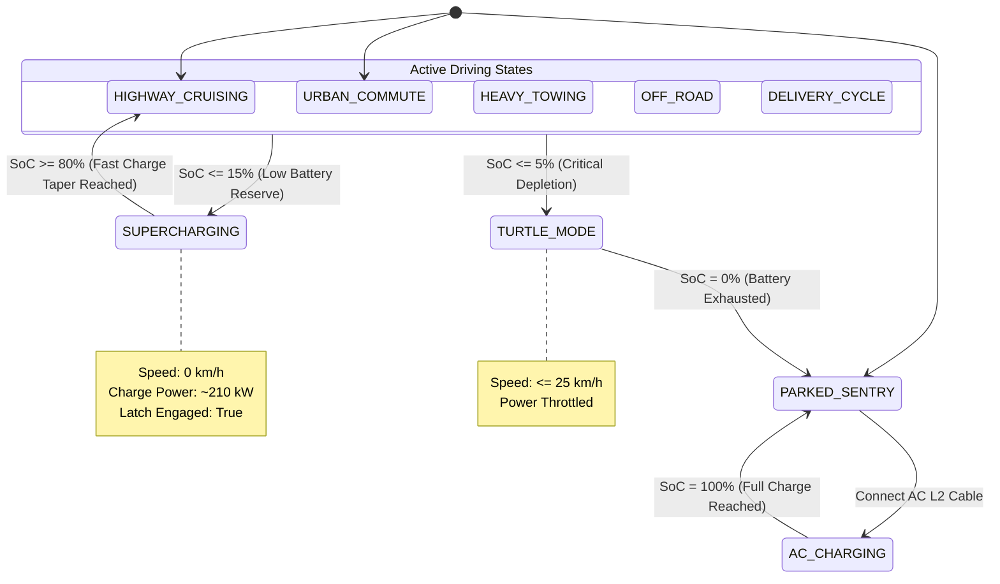
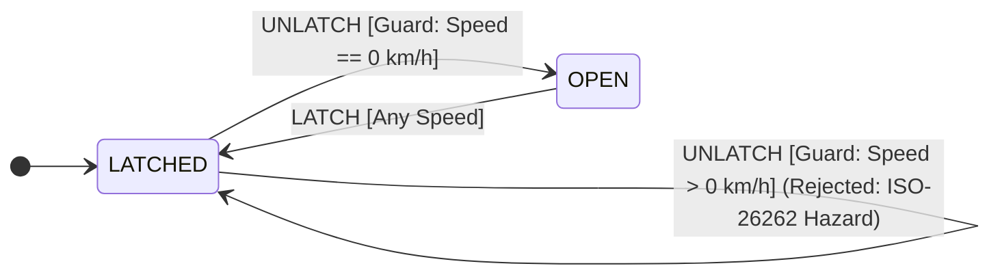

# Rivian-Inspired Fleet Mission Control HMI

[](https://golang.org)
[](https://react.dev)
[](https://www.typescriptlang.org)
[](https://protobuf.dev)
[](https://threejs.org)
[](https://vitejs.dev)

Fleet Mission Control is a real-time connected vehicle telemetry and remote operations platform. The system is built with Go, React, and Three.js.

Electric vehicles send continuous sensor data, including battery temperatures, inverter current, tire pressures, and GPS coordinates. Fleet operators must also send remote commands to vehicles safely and receive prompt feedback.

This platform implements the full operational lifecycle:
1. **Telemetry Ingestion:** Vehicles send binary Protocol Buffer frames across persistent TCP connections to a concurrent Go worker pool and digital twin cache.
2. **Cryptographic Dispatch:** The gateway signs outgoing commands with an ECDSA private key. The vehicle Electronic Control Unit (ECU) verifies signatures, timestamps, and nonces before execution.
3. **Finite State Machines & Safety:** An onboard generic FSM engine manages autonomous vehicle operational lifecycles and enforces ISO-26262 ASIL-B interlocks (e.g., rejecting attempts to unlatch cargo lids while in motion).
4. **Mission Control Dashboard:** A web interface displays real-time vehicle positions on California road networks, active diagnostic alerts, and an interactive 3D digital twin.

---

## Architecture

```
                      ┌──────────────────────────────────────────────┐
                      │          Vehicle Fleet Simulator             │
                      │  • 9 Real-world EV Models                    │
                      │  • California OSRM/OSM Road Following        │
                      │  • Finite State Machine (FSM) Lifecycle      │
                      │  • ISO-26262 Functional Safety Interlocks    │
                      └───────┬──────────────────────────────▲───────┘
                              │                              │
         [Telemetry Stream]   │ Length-Prefixed TCP Stream   │ [Command Channel]
         Binary Protobuf      │ [len][type][payload]         │ ECDSA Signed Commands
                              ▼                              │
                      ┌──────────────────────────────────────┴───────┐
                      │                Gateway (:8080)               │
                      │  • Concurrent TCP Session Registry           │
                      │  • Thread-Safe Frame Reader / Writer         │
                      │  • ECDSA SHA-256 Command Signer              │
                      └───────┬──────────────────────────────▲───────┘
                              │                              │
                              ▼                              │
                      ┌──────────────────────┐               │
                      │ TelemetryWorkerPool  │               │
                      │ • Bounded queue      │               │
                      │ • Rules engine       │               │
                      │ • Digital twin cache │               │
                      └───────┬──────────────┘               │
                              │                              │
                              ▼                              │
                      ┌──────────────────────────────────────┴───────┐
                      │          HTTP & WebSocket API (:8081)        │
                      │  • WS /api/v1/fleet/stream                   │
                      │  • WS /api/v1/alerts/stream                  │
                      │  • POST /api/v1/vehicles/{vin}/command       │
                      └───────┬──────────────────────────────▲───────┘
                              │                              │
                              ▼                              │
                      ┌──────────────────────────────────────┴───────┐
                      │             Mission Control HMI              │
                      │  • Live Leaflet Fleet Map                    │
                      │  • Interactive 3D WebGL Digital Twin         │
                      │  • Telemetry Indicators & Arc Gauges         │
                      │  • Actuator Hotspots with Interlock Feedback │
                      └──────────────────────────────────────────────┘
```

---

## Technical Description

### 1. Binary Wire Framing Across Raw TCP
Vehicles maintain persistent TCP connections to the gateway instead of sending JSON over HTTP.

To prevent TCP stream fragmentation and packet coalescing during high network traffic, every frame contains a 5-byte header:
* `[4 bytes]`: Big-endian payload length (integer)
* `[1 byte]`: Message type identifier (`0x01` = Telemetry, `0x02` = Command, `0x03` = Command Acknowledgment)
* `[N bytes]`: Google Protocol Buffers binary payload

This format minimizes serialization overhead. A single TCP socket handles telemetry streams, remote commands, and acknowledgments concurrently.

### 2. Concurrent Worker Pool and Thread-Safe Digital Twins
* **Worker Pool:** Ingestion workers process incoming telemetry from bounded Go channels. When channel capacity fills, non-blocking select statements drop excess packets to prevent gateway memory exhaustion.
* **In-Memory Digital Twin:** A thread-safe registry guarded by `sync.RWMutex` caches the latest state snapshot for each vehicle. The WebSocket server reads this cache without memory allocations.
* **Rules Engine:** When telemetry arrives, the rules engine checks for anomalies on each update cycle:
  * High battery pack temperature (temperature exceeds 55°C).
  * Cell voltage imbalance (voltage difference between cells exceeds 0.1V).
  * Speed limit violations and low tire pressure (TPMS) warnings.

### 3. Cryptographic Commands and ISO-26262 Safety
* **ECDSA Command Signatures:** When an operator sends a command, the gateway signs the payload with an ECDSA private key (`secp256r1` curve with SHA-256). The vehicle verifies the signature with the public key before it triggers vehicle actuators.
* **Replay Protection:** Each command contains a strictly increasing nonce and a Unix timestamp. The vehicle rejects any command received outside a 5-second validity window.
* **Safety Interlocks:** The simulator enforces functional safety rules based on ISO-26262 principles:
  * Rejects commands to open the front trunk or tailgate when ground speed exceeds 0 km/h via closure safety FSM guards.
  * Rejects commands to shift out of Park while the vehicle is charging.
  * Executes safe actions (such as setting a speed limit governor) and synchronizes telemetry immediately.

### 4. Finite State Machines (FSM) & Autonomous Lifecycles
The vehicle simulator embeds a generic, type-safe Finite State Machine engine (`internal/simulator/fsm.go`) that governs vehicle operational lifecycles and actuator safety:
* **Generic State Machine:** Go parameterized type `FSM[S, E, C]` with thread-safe transition maps (`sync.RWMutex`), `GuardFunc` predicate validators, and `ActionFunc` callbacks for side-effects.
* **Autonomous Operational Lifecycle:** Evaluates real-time battery electrochemistry and vehicle physics:
  * Reroutes driving vehicles (`HIGHWAY_CRUISING`, `URBAN_COMMUTE`, `HEAVY_TOWING`) to `SUPERCHARGING` when battery SoC drops $\le 15\%$.
  * Tapers current at 80% SoC, disconnects charger, and resumes `HIGHWAY_CRUISING` at 110 km/h.
  * Throttles power output to `TURTLE_MODE` (capped at 25 km/h) if battery SoC drops $\le 5\%$.
  * Transitions `AC_CHARGING` to `PARKED_SENTRY` upon reaching 100% full charge.
* **ISO-26262 ASIL-B Closure Safety FSM:** Closures (`frunk`, `tailgate`) operate as state machines with speed-gated guards that reject unlatching commands whenever ground speed exceeds 0 km/h.
* **Diagnostic Audit History:** Every state change is recorded into a ring buffer with timestamps, prior state, event, new state, and reason.

#### Operational Lifecycle FSM Diagram


#### ISO-26262 Closure Safety FSM Diagram


### 5. Road-Following Fleet Simulator
* Vehicles follow realistic road coordinates in California (San Francisco, Silicon Valley, Monterey, and Lake Tahoe) mapped with OSRM and OpenStreetMap.
* The engine simulates 9 EV vehicle models across realistic operational profiles with dynamic physics:
  * Highway cruising and urban traffic with regenerative braking.
  * Heavy towing and cold-weather operation.
  * Direct current (DC) fast charging with automated current tapering above 80% state of charge.

### 6. Mission Control HMI and 3D Digital Twin
* **HMI Design System:** Clean operational interface with Day and Night modes, speed and power arc gauges, and battery state-of-charge indicators.
* **3D Digital Twin (React Three Fiber and Three.js):**
  * Wheel rotation speed synchronizes with real-time telemetry speed.
  * Doors and cargo lids animate open and closed.
  * Clickable 3D hotspots allow operators to command door locks, the front trunk, and the tailgate directly on the vehicle model.
* **Optimistic UI Updates:** Actuator buttons indicate pending state immediately upon click. If the vehicle safety layer rejects the command, the interface reverts to the confirmed vehicle state.
* **Unit Conversion:** The user interface converts between imperial and metric units (mph and km/h, mi and km, °F and °C, psi and bar).

---

## Tech Stack

* **Backend:** Go 1.27+ (`net`, `sync`, `crypto/ecdsa`, goroutines, channels)
* **Serialization:** Google Protocol Buffers (`proto3`)
* **Transport:** Length-prefixed TCP sockets, WebSockets, HTTP REST
* **Frontend:** React 18, TypeScript, Vite, Vanilla CSS Design System
* **3D Visualizations:** Three.js, React Three Fiber, Drei
* **Mapping:** Leaflet, OpenStreetMap, OSRM

---

## Running Locally

### Prerequisites
* **Go** (version 1.27 or newer)
* **Bun** (or Node.js 18+ and npm)

### 1. Clone the Repository
```bash
git clone https://github.com/itsnairr/FleetMissionControl.git
cd FleetMissionControl
```

### 2. Start the Gateway Server
The gateway generates ECDSA keys, accepts vehicle TCP connections on port 8080, and serves the HTTP and WebSocket API on port 8081:
```bash
go run ./cmd/gateway
```

### 3. Start the Vehicle Simulator
Open a second terminal window. Start the simulator to generate connected vehicles driving on California routes:
```bash
# Starts 10 concurrent simulated vehicles
go run ./cmd/simulator -n 10
```

### 4. Start the Web Dashboard
Open a third terminal window. Install dependencies and start the development server:
```bash
cd web
bun install     # or npm install
bun run dev     # or npm run dev
```

Open **`http://localhost:5173`** in your browser.

---

## Testing and Quality Verification

Run the Go unit and integration tests to verify framing, cryptographic signatures, command dispatching, and API endpoints:
```bash
go test -v ./...
```

Run the automated performance benchmarks (`testing.B` and in-process network testbed):
```bash
go test -bench=. ./cmd/bench
# or run the full 3-pass automated benchmark suite:
go run ./cmd/bench
```

Measured performance numbers, latency percentiles, and bandwidth efficiency ratios are documented in [BENCHMARKS.md](BENCHMARKS.md).

Verify frontend TypeScript types and compile the production build:
```bash
cd web
bun run build
```

---

## API Reference

### REST Endpoints
* `GET /api/v1/vehicles`: Returns a snapshot of all registered vehicles with online status.
* `GET /api/v1/vehicles/{vin}`: Returns current telemetry data for the specified Vehicle Identification Number (VIN).
* `POST /api/v1/vehicles/{vin}/command`: Transmits a cryptographically signed command to the vehicle. The gateway waits up to 3 seconds for the vehicle response:
  * `200 OK`: Command accepted or rejected by vehicle safety logic (the response body contains the verdict and reason).
  * `503 Service Unavailable`: Target vehicle is offline.
  * `504 Gateway Timeout`: Target vehicle did not reply within 3 seconds.

### WebSocket Streams
* `WS /api/v1/fleet/stream`: Streams continuous digital twin state updates for all vehicles in the fleet.
* `WS /api/v1/vehicles/{vin}/stream`: Streams high-frequency telemetry for one selected vehicle.
* `WS /api/v1/alerts/stream`: Streams alerts generated by the rules engine and vehicle Diagnostic Trouble Codes (DTC).

---

## Project Structure

```
FleetMissionControl/
├── certs/                      # ECDSA keys for command signing and validation
├── cmd/
│   ├── bench/                  # Rigorous Go automated performance benchmark harness
│   ├── gateway/                # TCP ingest listener, crypto signer, HTTP/WS server
│   └── simulator/              # Concurrent EV physics and route simulation engine
├── internal/
│   ├── api/                    # REST and WebSocket handlers
│   ├── command/                # Command dispatcher and response registry
│   ├── crypto/                 # ECDSA key generation and signature verification
│   ├── protocol/               # Generated Protobuf Go structs
│   ├── pubsub/                 # In-memory pub/sub fan-out broker
│   ├── rules/                  # Real-time anomaly detection rules engine
│   ├── session/                # Active vehicle TCP connection registry
│   ├── simulator/              # Vehicle state machines, physics, and routes
│   ├── twin/                   # In-memory digital twin registry
│   ├── wire/                   # Length-prefixed framing reader and writer
│   └── worker/                 # Actor-style concurrent telemetry worker pool
├── proto/
│   ├── telemetry.proto         # Protobuf contract for BMS, dynamics, and cabin state
│   └── command.proto           # Protobuf contract for remote vehicle commands
├── tools/
│   └── routegen/               # Route extraction scripts for California highways
└── web/                        # React + TypeScript + Vite operations dashboard
    ├── src/
    │   ├── api/                # Typed REST and WebSocket client
    │   ├── components/         # FleetList, FleetMap, SpeedGauge, VehicleDetail, TopBar
    │   ├── hooks/              # useFleet, useCommands, useAlerts, useTheme
    │   ├── lib/                # Closures, units, model registries, optimistic updates
    │   └── three/              # Three.js / React Three Fiber 3D digital twin
    └── styles.css              # Mission Control design system
```

---

## Credits

* 3D Car Models: [Car Kit 3.1](https://kenney.nl/assets/car-kit) by Kenney ([CC0 1.0](https://creativecommons.org/publicdomain/zero/1.0/)).
* Map Tiles: © [OpenStreetMap](https://www.openstreetmap.org/copyright) contributors.
* Road Networks: Generated using [OSRM](https://project-osrm.org).

